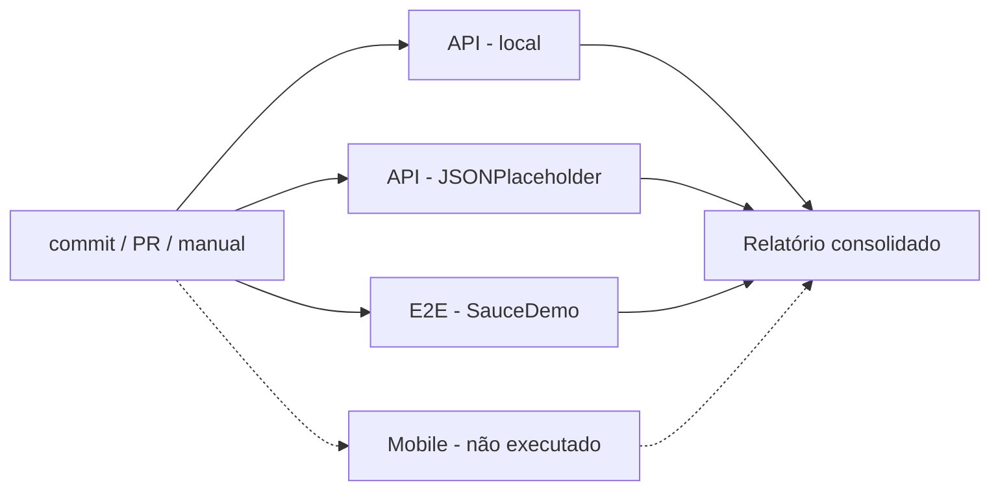

# QA Automation Pipeline (CI/CD com GitHub Actions)

Monorepo com os testes automatizados de **API** e **E2E**, executados automaticamente a cada commit por
um pipeline no GitHub Actions, que no final gera um **relatório consolidado**.

```
.
├── .github/workflows/ci.yml   Pipeline (GitHub Actions)
├── ci/build-report.js         Gera o relatório consolidado do pipeline
├── api-tests/                 Testes de API (Playwright APIRequestContext)
├── e2e-tests/                 Testes E2E (Cucumber + Playwright + TypeScript, SauceDemo)
└── mobile-tests/              Testes mobile: NÃO executados (ver README da pasta)
```

## Pipeline



| Job | O que faz | Artefato publicado |
|---|---|---|
| `api` (matriz: `local`, `jsonplaceholder`) | `npm ci`, executa a suíte de API e gera o relatório em texto | `api-local-reports`, `api-jsonplaceholder-reports` (HTML, JSON, JUnit, TXT/MD) |
| `e2e` | `npm ci`, instala o Chromium, executa os cenários Cucumber em modo headless | `e2e-reports` (HTML, JSON, JUnit, screenshots por cenário) |
| `mobile` | Placeholder: só roda em disparo manual com `run_mobile=true`; nos commits fica *skipped* | — |
| `report` | Roda **sempre** (mesmo com falhas), baixa os artefatos e gera o relatório | `pipeline-report` (`RELATORIO-PIPELINE.txt` e `.md`) |

Decisões de configuração:

- **Gatilhos:** `push` em qualquer branch, `pull_request` e `workflow_dispatch` (manual).
- **Paralelismo:** API (2 suítes) e E2E rodam ao mesmo tempo; `fail-fast: false` para que uma falha não
  cancele as demais e o relatório mostre o quadro completo.
- **Concorrência:** um novo commit na mesma branch cancela a execução anterior ainda em andamento.
- **Cache:** `actions/setup-node` com cache do npm por projeto (`package-lock.json`) e `npm ci` para
  instalação reproduzível.
- **Navegador só onde precisa:** o Chromium é instalado apenas no job E2E; os testes de API usam só HTTP.
- **Evidências sempre publicadas:** os uploads usam `if: always()`, então relatórios e screenshots ficam
  disponíveis mesmo quando os testes falham.
- **Permissões mínimas:** `contents: read`.

## Onde ver o relatório

1. Aba **Actions** do repositório, na execução desejada.
2. A página da execução mostra o **resumo consolidado** (tabelas por suíte, positivos x negativos,
   falhas e detalhamento de cada teste), vindo do job `report`.
3. Na seção **Artifacts** da mesma página, baixe os relatórios completos (HTML do Cucumber com
   screenshots, HTML do Playwright, `RELATORIO-PIPELINE.txt`).

## Como publicar no GitHub

```bash
git init
git add .
git commit -m "feat: monorepo de testes com pipeline CI"
git branch -M main
git remote add origin https://github.com/<usuario>/<repositorio>.git
git push -u origin main
```

O primeiro push já dispara o pipeline. Para novas execuções, faça um commit ou use
**Actions → CI - Testes automatizados → Run workflow**.

## Executar localmente

```bash
# API
cd api-tests && npm ci && npm test && npm run test:jsonplaceholder

# E2E (abre o navegador; use HEADLESS=true para rodar sem janela)
cd e2e-tests && npm ci && npx playwright install chromium && npm test
```

## Observações e limitações

- **Mobile não é executado** (fora do escopo). O job está declarado e documentado em `mobile-tests/README.md`.
- **Dependência de serviços públicos:** o E2E roda contra `saucedemo.com` e uma das suítes de API contra
  `jsonplaceholder.typicode.com`. Se esses serviços ficarem fora do ar ou limitarem requisições, o job
  correspondente falha por motivo externo ao código.
- **Alteração no projeto E2E:** em `e2e-tests/src/support/hooks.ts`, o navegador agora abre em modo
  headless quando `CI=true` (GitHub Actions define essa variável) ou `HEADLESS=true`. Sem isso o job
  falharia, pois o runner não tem tela. Localmente o comportamento anterior (janela visível) é mantido.
  Também foi adicionado o script `test:ci`, que gera o relatório JUnit além dos já existentes.
- Os relatórios dos artefatos ficam retidos por 30 dias.
