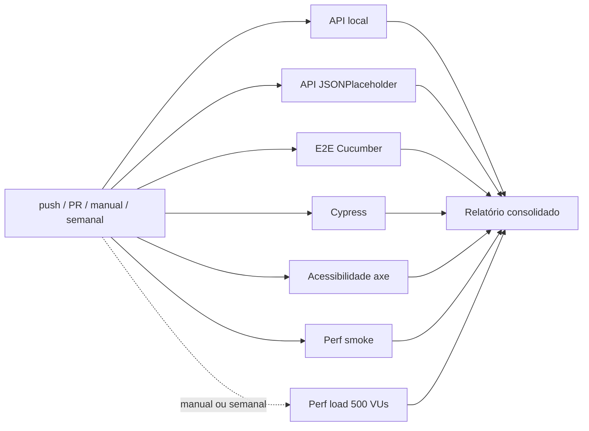

# QA Automation Pipeline

Monorepo de automação de testes com pipeline de CI/CD no GitHub Actions: **API**, **E2E** (Playwright/Cucumber e Cypress),
**acessibilidade**, **performance** e um **relatório consolidado** a cada execução.

```
.
├── .github/workflows/ci.yml   Pipeline (GitHub Actions)
├── ci/build-report.js         Relatório consolidado do pipeline (.txt, .md e resumo da execução)
├── api-tests/                 API: Playwright (APIRequestContext) + contrato JSON Schema/Ajv
├── e2e-tests/                 E2E: Cucumber + Playwright + TypeScript (SauceDemo) e acessibilidade (axe-core)
├── cypress-tests/             E2E: mini-suíte Cypress com cenários representativos
├── load-tests/                Performance: k6 (smoke e load), evidências e análise
└── mobile-tests/              Mobile: NÃO executado (ver README da pasta)
```

## 1. Estratégia

Pirâmide enxuta, cada camada com um papel diferente (sem duplicar o que outra já cobre):

| Camada | Ferramenta | Alvo | O que garante | Volume |
|---|---|---|---|---|
| **API** | Playwright `APIRequestContext` | API de exemplo local (`api-tests/server`) e JSONPlaceholder | GET/POST/PUT/DELETE, positivos e negativos, headers, status, idempotência, métodos inválidos, autenticação | 76 + 67 testes |
| **Contrato** | JSON Schema + Ajv | endpoints representativos das duas APIs | formato das respostas (tipos, obrigatórios, sem campos extras, formato de erro) | 13 + 5 (incluídos nos totais de API) |
| **E2E (principal)** | Cucumber + Playwright + TS | SauceDemo | jornadas de login e checkout em BDD, Page Object, evidências | 10 cenários |
| **E2E (Cypress)** | Cypress + TS | SauceDemo | demonstra a ferramenta com cenários representativos (login, rota protegida, checkout), `cy.session`, Page Objects | 10 testes |
| **Acessibilidade** | axe-core + Playwright | 8 telas das jornadas críticas | violações WCAG A/AA `critical`/`serious` reprovam | 13 testes |
| **Performance** | k6 | API de exemplo local (ou `BASE_URL`) | latência p95/p99, vazão e erros sob carga | smoke + load |
| **Mobile** | — | — | fora do escopo | — |

Os números são da última validação completa feita para esta entrega (API e E2E/acessibilidade contra réplicas locais, ver "Limitações").

Decisões de arquitetura que valem destacar:

- **Configuração sem valores fixos:** URL, credenciais, timeouts e políticas de evidência vêm de variáveis de ambiente (`E2E_*`), centralizadas em `e2e-tests/src/support/config.ts` e `cypress-tests/cypress.config.ts`; no CI, de *variables/secrets* do repositório.
- **Isolamento barato no E2E:** um `Browser` por suíte, um `BrowserContext` novo por cenário; **Playwright Trace** só dos cenários que falham.
- **Assertions com auto-wait:** `expect(locator).toHaveText/toHaveURL/toBeVisible` em vez de extrair e comparar (reduz flakiness).
- **Qualidade > volume na API:** o contrato complementa os asserts funcionais, com controle negativo provando que o validador detecta quebras.
- **Gate de acessibilidade comprovado:** testes de controle provam que página ruim reprova e página boa passa; baseline só aceita exceções justificadas.

## 2. Pipeline (CI/CD)



| Job | Quando roda | O que faz | Artefato |
|---|---|---|---|
| `api` (matriz `local`, `jsonplaceholder`) | todo commit | suíte de API + contrato | `api-*-reports` |
| `e2e` | todo commit | Cucumber + Playwright, headless | `e2e-reports` (HTML, JSON, JUnit, screenshots, **traces das falhas**) |
| `cypress` | todo commit | typecheck + `cypress run` no Chrome | `cypress-reports` (JUnit, resumo JSON, screenshots de falha) |
| `a11y` | todo commit | axe nas jornadas críticas | `a11y-reports` (HTML, JSON, JUnit) |
| `perf-smoke` | todo commit | k6 perfil smoke (1 min, 2 usuários) | `perf-smoke-reports` |
| `perf-load` | **semanal (seg. 06:00 UTC) ou manual** (`run_load`; `load_vus`, `load_ramp_up`, `load_hold`) | k6 perfil load (500 VUs, 5 min) | `perf-load-reports` |
| `mobile` | só manual (`run_mobile`) | placeholder, fica *skipped* | — |
| `report` | **sempre**, mesmo com falhas | consolida tudo | `pipeline-report` (`RELATORIO-PIPELINE.txt/.md`) |

Configuração: gatilhos `push`, `pull_request`, `workflow_dispatch`, `schedule`; `fail-fast: false` (uma falha não cancela as outras e o relatório fica completo);
um novo commit na mesma branch cancela a execução anterior; cache do npm e do binário do Cypress; uploads com `if: always()`; permissões mínimas (`contents: read`).
O carga completo **não** roda por commit: dura ~7 min e satura o runner.

### Critérios de aprovação

O pipeline (e o relatório) só ficam **APROVADOS** se **todos** forem verdade:

1. Todos os testes de API (funcionais e de contrato), E2E, Cypress e acessibilidade passam (nenhum reprovado; nenhuma suíte sem resultado).
2. Nenhuma violação de acessibilidade `critical`/`serious` fora do baseline justificado.
3. Perfil smoke do k6 com **todos os thresholds** atendidos: p95 < 300 ms, p99 < 600 ms, falhas < 0,5 %, checks > 99 %, vazão mínima.
4. Se o carga foi executado: thresholds do perfil load atendidos (p95 < 500 ms, p99 < 1000 ms, falhas < 1 %, vazão > 400 req/s).
5. Mobile não entra (fora do escopo).

## 3. Relatórios e evidências

- **Resumo na página da execução** (aba *Actions*): tabela de jobs, resultado por suíte, positivos x negativos, falhas, performance (p95/p99/vazão) e detalhamento de cada teste.
- **Artefatos** (retidos 30 dias): relatórios HTML/JSON/JUnit de cada suíte, screenshots, traces de falha do E2E, resumo e dashboard do k6, `RELATORIO-PIPELINE.txt` para anexar/entregar.
- **Trace de uma falha de E2E:** baixar `e2e-reports`, `npx playwright show-trace traces/<cenario>.zip`.
- **Performance:** execução de referência e análise em `load-tests/evidencias/` e `load-tests/ANALISE-DE-PERFORMANCE.md`.

## 4. Executar localmente

```bash
# API (sobe o mock sozinho) e contrato
cd api-tests && npm ci && npm test && npm run test:jsonplaceholder

# E2E principal e acessibilidade
cd e2e-tests && npm ci && npx playwright install chromium && npm test && npm run test:a11y

# Cypress
cd cypress-tests && npm ci && npm test

# Performance (requer k6)
cd load-tests && ./scripts/run.sh smoke        # ou: ./scripts/run.sh load
```
Para outro ambiente: `E2E_BASE_URL=... E2E_PASSWORD=... npm test` (E2E/Cypress/a11y), `API_BASE_URL=...` (API), `BASE_URL=...` (k6).
Cada pasta tem seu README com detalhes.

## 5. Limitações conhecidas

- **Serviços públicos de terceiros:** o E2E, o Cypress e a acessibilidade rodam contra `saucedemo.com`; uma suíte de API, contra `jsonplaceholder.typicode.com`.
  Indisponibilidade ou limite de requisições deles reprova o job por motivo externo ao código.
- **Acessibilidade do SauceDemo não foi medida contra o site real** (o ambiente de desenvolvimento não tinha acesso a ele; foi validada em uma réplica local e com páginas de controle).
  É um app de demonstração de terceiros e é plausível que tenha violações próprias (ex.: contraste). **Na primeira execução real o job `a11y` pode falhar**: isso é o critério funcionando.
  Abra o relatório, corrija o que for seu e, para o que não for, registre em `e2e-tests/a11y/known-issues.json` com justificativa (ou ajuste `A11Y_FAIL_ON`).
  O axe automatizado cobre só parte dos problemas; não substitui revisão manual.
- **Cypress não foi executado durante o desenvolvimento** (o binário não pôde ser baixado no ambiente restrito): o código passa em `tsc` (tipos do Cypress), mas a primeira execução real acontece no CI.
  Se algum seletor/mensagem do SauceDemo divergir, o ajuste é local nos Page Objects.
- **Performance:** o alvo é um mock em memória, com gerador e servidor na mesma máquina (2 vCPUs) e uma execução por perfil; a carga é de modelo fechado (usuários com pausa).
  Os resultados validam a solução e dão uma linha de base, mas **não** representam a capacidade de um sistema real. Detalhes em `load-tests/ANALISE-DE-PERFORMANCE.md`.
  Em runner compartilhado do GitHub os números oscilam; os thresholds são conservadores de propósito.
- **E2E de referência validado em réplica local** do SauceDemo (mesmos seletores e fluxo) por falta de acesso ao site; no CI roda contra o real.
- **Mobile não é executado** (fora do escopo); `mobile-tests/README.md` descreve a integração prevista.
